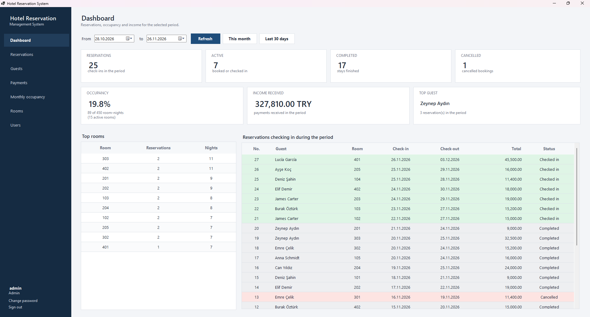
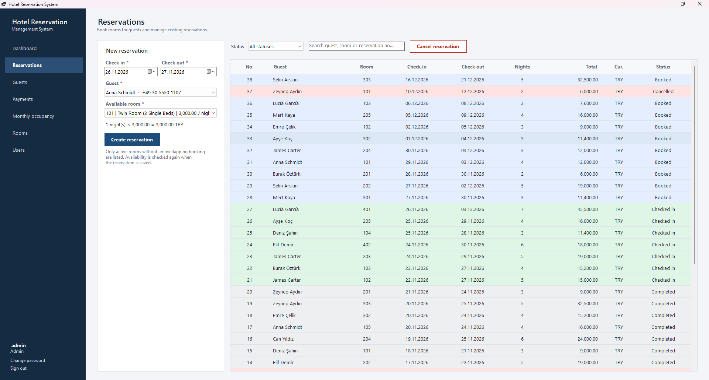
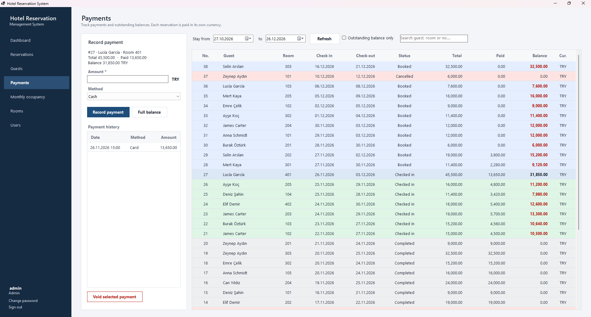
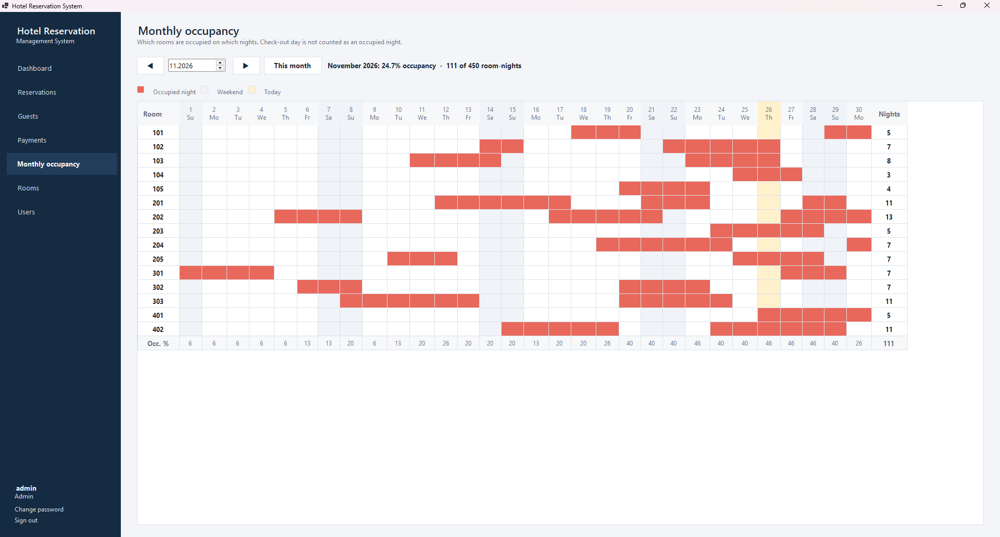
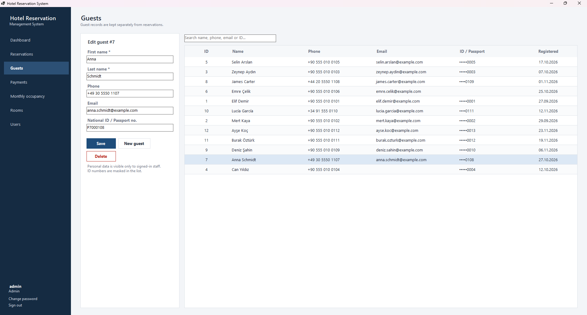
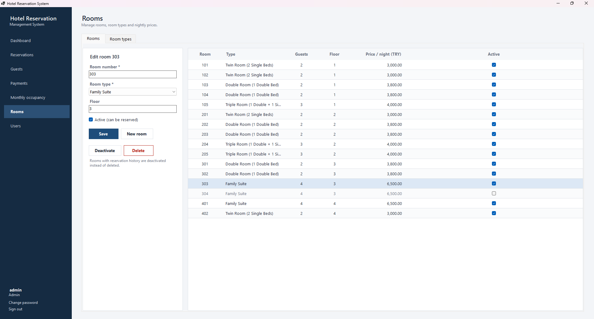
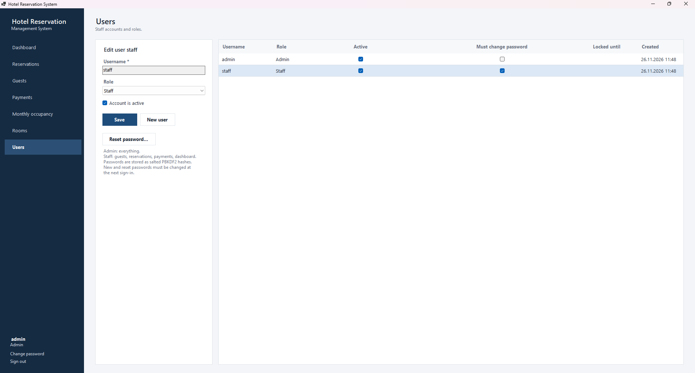
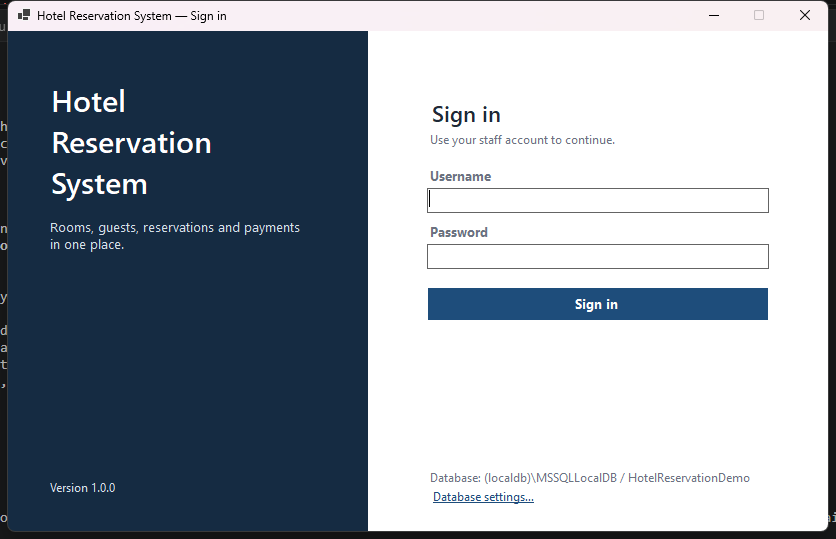
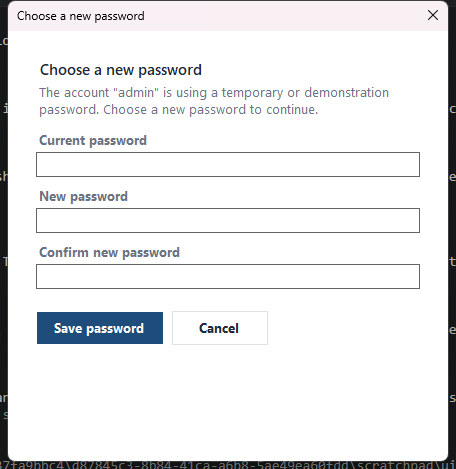
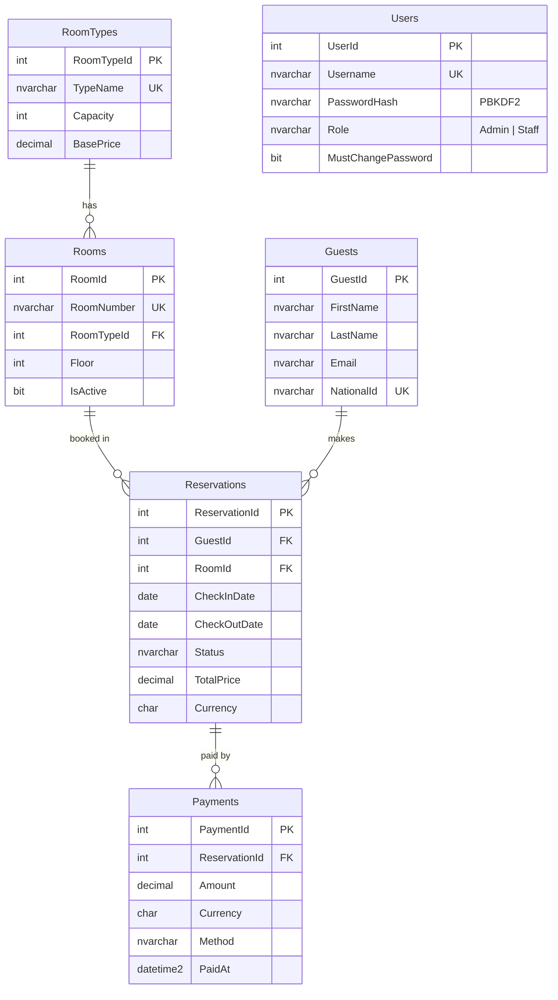

# Hotel Reservation System

[](https://github.com/agahatay/hotel-reservation-system/actions/workflows/build.yml)

A Windows desktop application for running the front desk of a small hotel: rooms and room
types, guests, reservations, payments, a management dashboard and a monthly occupancy calendar.
Built with **C#**, **.NET 10 Windows Forms** and **Microsoft SQL Server**.

Individually designed and developed by **Agah Atay Özbelli**.



**Download:** the latest Windows build is on the [Releases page](https://github.com/agahatay/hotel-reservation-system/releases/latest)
(self-contained — no .NET installation needed).

## Key features

| Area | What it does |
|---|---|
| **Reservations** | Book a room for a guest; only active rooms without an overlapping stay are offered. Overlap rule: `existing.CheckIn < new.CheckOut AND existing.CheckOut > new.CheckIn` (back-to-back stays are allowed, cancelled stays release the room). The booking is re-checked inside a `SERIALIZABLE` transaction with an update lock on the room, so two clerks can never double-book the same room. The total price is fixed at booking time. |
| **Reservation lifecycle** | `Booked → CheckedIn → Completed` by date; only bookings that have not started can be cancelled. |
| **Payments** | Partial payments, outstanding balance, payment history, overpayment protection (also under concurrency). Each reservation has one currency and totals are never mixed across currencies. Admins can void a mistaken payment. |
| **Guests** | Guest records kept separately from reservations; validation of names, phone, e-mail and ID; ID/passport numbers masked in lists; guests with reservation history cannot be deleted. |
| **Rooms** | Rooms and room types with capacity and nightly price; rooms with history are deactivated instead of deleted. |
| **Dashboard** | Reservations by status, occupancy in room-nights, income per currency, top rooms and top guest for any period. |
| **Monthly occupancy** | Room × night calendar with daily occupancy percentages. |
| **Users & security** | Admin / Staff roles, PBKDF2 password hashing, account lockout, forced password change for new, reset and demo accounts. |
| **Setup** | The app can create its own database on SQL Server Express or LocalDB (no `sqlcmd` needed). |

## Screenshots

| | |
|---|---|
|  |  |
| **Reservations** — new booking with price preview, status-coloured list | **Payments** — balances, partial payments and history |
|  |  |
| **Monthly occupancy** — occupied nights per room | **Guests** — editor and searchable list |
|  |  |
| **Rooms** — rooms and room types (Admin) | **Users** — roles and account state (Admin) |
|  |  |
| **Sign in** | **Forced password change** on first sign-in |

All screenshots are of the running application with the fictional demo data.

## Technologies

C# 14 · .NET 10 (Windows Forms) · Microsoft SQL Server 2016+ (Express / LocalDB) · ADO.NET with
Microsoft.Data.SqlClient · xUnit · GitHub Actions

## Architecture

```
src/
  HotelReservationSystem.Core/   class library — no UI code
    Models/          entities and view models
    Domain/          pure business rules (overlap, pricing, payments, occupancy, validation, roles)
    Security/        password hashing and login policy
    Data/            SQL repositories, transactions, database installer (embedded SQL scripts)
    Services/        use cases: authorization + rules + transactions
    Configuration/   connection-string resolution
  HotelReservationSystem/        Windows Forms application
    Forms/  Pages/  Common/      shell window, one page per screen, shared UI toolkit
database/                        schema.sql, seed.sql (fictional), setup-database.ps1
tests/                           unit tests and SQL Server integration tests
build/                           publish script for the Windows release
```

Forms only call services; services enforce permissions and business rules and own the
transactions; repositories contain only parameterized SQL. More detail: [docs/architecture.md](docs/architecture.md).

## Database design



Money is `decimal(12,2)` (never floating point), stay dates are `date`. Check constraints guard
dates (`CheckOutDate > CheckInDate`), statuses, amounts, currencies and roles. The index
`(RoomId, CheckInDate, CheckOutDate)` supports the availability check and its range locks.
Full script: [database/schema.sql](database/schema.sql).

## Installation

Requirements: Windows 10/11 x64 and SQL Server 2016+ (the free **SQL Server Express** or **LocalDB** is enough).

1. Download `HotelReservationSystem-v1.0.0-win-x64.zip` from [Releases](https://github.com/agahatay/hotel-reservation-system/releases) and extract it.
2. Run `HotelReservationSystem.exe`.
3. If the database does not exist yet, the **Database settings** window opens. Enter the server
   (`.\SQLEXPRESS` or `(localdb)\MSSQLLocalDB`), click **Create / update database**, choose whether to
   load the fictional demo data, then **Save**.
4. Sign in.

**Demo accounts** (only with the demo data): `admin / Admin123!` and `staff / Staff123!`.
These are public demonstration credentials for fictional data — you must change the password at
first sign-in, and they must never be used in production. For real use, create the database
without demo data and set up your own administrator in the first-run screen.

Step-by-step guide, `sqlcmd` alternative and troubleshooting: [docs/installation.md](docs/installation.md).

## Database configuration

The connection string is read from (first match wins):

1. environment variable `HOTELRES_CONNECTION_STRING`
2. `%APPDATA%\HotelReservationSystem\appsettings.json` — written by **Database settings**
3. `appsettings.json` next to the executable

The default is `Server=.\SQLEXPRESS;Database=HotelReservationDB;Integrated Security=True;Encrypt=True;TrustServerCertificate=True`.
Windows authentication is used, so no database password is stored anywhere.

## Running from source

```powershell
git clone https://github.com/agahatay/hotel-reservation-system.git
cd hotel-reservation-system
dotnet build -c Release
dotnet run --project src/HotelReservationSystem -c Release
```

Requires the .NET 10 SDK. Build the release package with `powershell -ExecutionPolicy Bypass -File build\publish.ps1`.

## Security

- **Passwords:** salted PBKDF2-HMAC-SHA256 (600,000 iterations, OWASP guidance), constant-time
  comparison, automatic re-hashing of weaker hashes. Plaintext passwords are never stored.
- **Login:** generic error messages, equal-cost path for unknown users, lockout for 5 minutes after
  5 failed attempts, disabled accounts, forced password change for temporary passwords.
- **Authorization:** checked in the service layer, not only by hiding buttons. Staff: guests,
  reservations, payments, dashboard. Admin: additionally rooms, room types, users and voiding payments.
  The last active administrator cannot be disabled.
- **SQL:** every query is parameterized with explicit SQL types; `LIKE` wildcards in search input are escaped.
- **Integrity:** foreign keys, check constraints, unique keys; booking and payment run in
  `SERIALIZABLE` transactions with update locks (verified by concurrency tests).
- **Privacy:** ID numbers masked in lists; only fictional data in this repository; no credentials in source or releases.

Note: as a two-tier desktop application, each user's Windows account connects to SQL Server
directly, so database permissions should be limited to the users who run the application.

## Testing

```powershell
dotnet test -c Release
```

- **138 unit tests** — business rules: overlap detection, pricing, payment validation, balances,
  occupancy, guest validation, password hashing, lockout, role permissions, configuration.
- **34 SQL Server integration tests** — run against a disposable database built from the real
  scripts: double-booking under 12 simultaneous requests, overlapping/back-to-back/cancelled
  stays, concurrent payments, authorization, lockout, forced password change, seed data validity.
  They need a local SQL Server (`.\SQLEXPRESS` by default, or set `HOTELRES_TEST_SERVER`).

GitHub Actions builds the solution and runs both suites on Windows (integration tests on LocalDB).
Test results and the manual UI test checklist: [docs/testing.md](docs/testing.md).

## Future improvements

- Editing the dates or room of an existing reservation
- Invoices / receipts as PDF and refund handling for cancelled prepaid bookings
- Multi-currency pricing with stored exchange rates
- Audit log of who created, cancelled or changed records
- A service/API tier so clients no longer need direct database access
- Localization (English / Turkish)

## Author

**Agah Atay Özbelli** — [github.com/agahatay](https://github.com/agahatay)

Licensed under the [MIT License](LICENSE).
